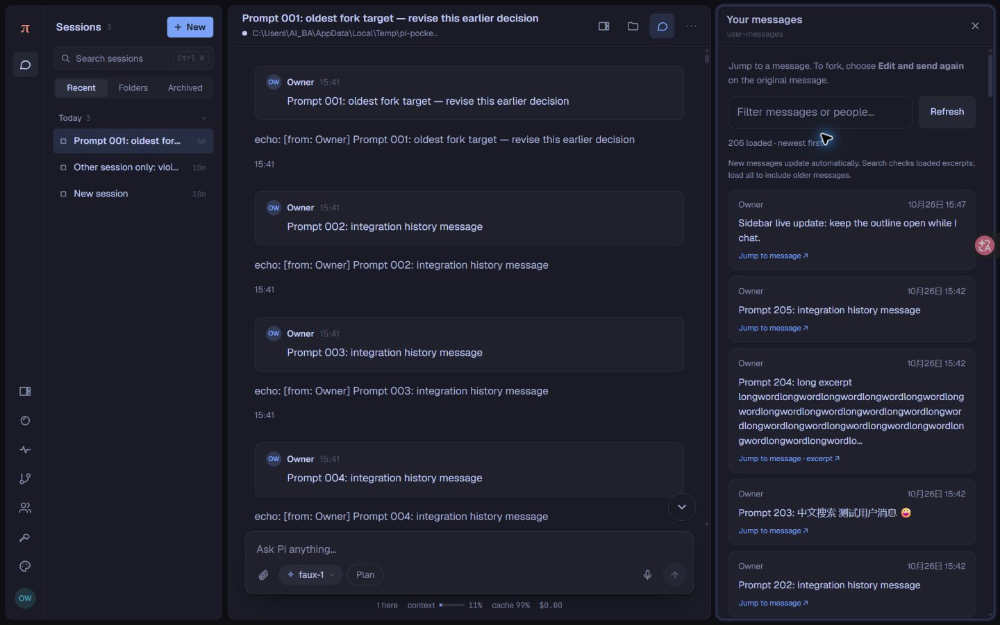

# 0.2.0 常驻消息侧栏验证

2026-10-26，Windows / Node 24.14.1 / Microsoft Edge，Pi Pocket 0.21.0（`7d6fbb0`）。使用独立临时数据、205 条消息和上游脚本模型，未操作主实例。

## 行为

- 使用原生 `pocket.panel`，桌面端与聊天并排显示。由 Pi Pocket 保存当前标签页的展开状态；用户主动关闭或打开其他原生面板时，不强行重新打开。
- 点击消息只跳转；在小于 1100px 的窗口先关闭覆盖面板，再定位消息。宽屏保持侧栏、筛选条件和已加载历史。
- 侧栏可见时每 5 秒检查最新一页，重新显示标签页时立即检查。后台更新保留已加载历史，不抢占手动加载，不弹出网络错误提示；手动刷新仍可重试并显示错误。
- 关闭侧栏、切换会话、禁用扩展后清理请求与订阅。自动更新不使用私有 Pi Pocket 状态或额外服务。

## 界面实测

| 操作 | 结果 |
| --- | --- |
| 1440×900 打开 Your messages | 右侧常驻，聊天输入框同时可用 |
| Load older / Load all | 共 205 条；筛选 Prompt 001 并跳转后仍为 205 条 |
| 连续跳转 Prompt 001、中文 Prompt 203 | 侧栏保持展开，原消息在聊天视口内；筛选内容保留 |
| 切换第二会话、空会话 | 侧栏继续显示，筛选清空，内容分别为 1 条和空状态 |
| 刷新网页 | 原生侧栏自动恢复 |
| 主动关闭后刷新 | 保持关闭 |
| 侧栏展开时发送消息 | 聊天收到脚本模型回显；列表自动从 205 条变为 206 条，旧筛选和历史保留 |
| 打开 Files | 正常替换消息侧栏；关闭 Files 后可以重新打开消息侧栏 |
| 390×844 手机尺寸 | 面板内容宽度和滚动宽度均为 362px，操作按钮至少 44px |
| 手机点击中文消息 | 覆盖面板收起，消息位于聊天视口内，输入框可用 |
| 1099 / 1100px 断点 | 1099px 跳转收起覆盖面板，1100px 保持并排侧栏 |

手机验证使用浏览器视口模拟，不等同于实体手机或 iOS Safari 测试。

## 自动化验证

- `npm run check`：通过。
- `npm test`：50/50 通过，包括增量更新、游标保留、历史重置、会话切换、取消和过期响应。
- `npm run test:integration`：6/6 通过，使用真实扩展加载器、HTTP 和临时数据。
- `git diff --check`：通过。
- 全部代码就绪并刷新页面后的浏览器检查没有新增应用错误。

测试服务已停止，测试标签页已关闭，浏览器视口设置已恢复。手动测试实例的临时目录清理被自动审批拒绝（工具仅返回 `blocked by policy`），该目录仍保留；自动化集成测试自行清理完成。
